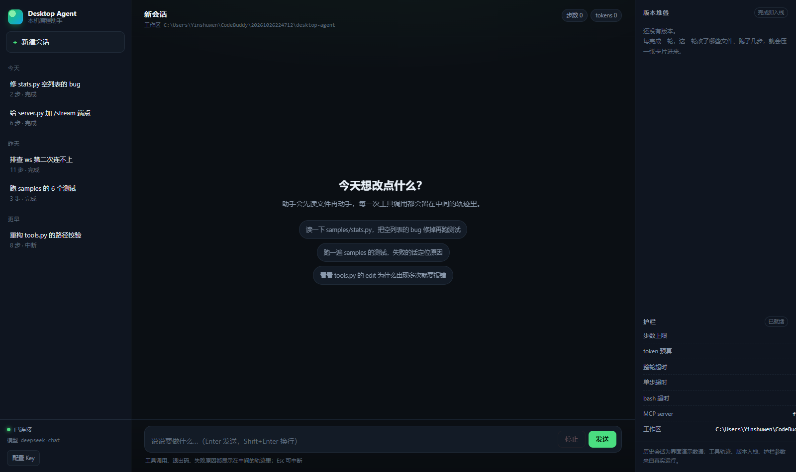
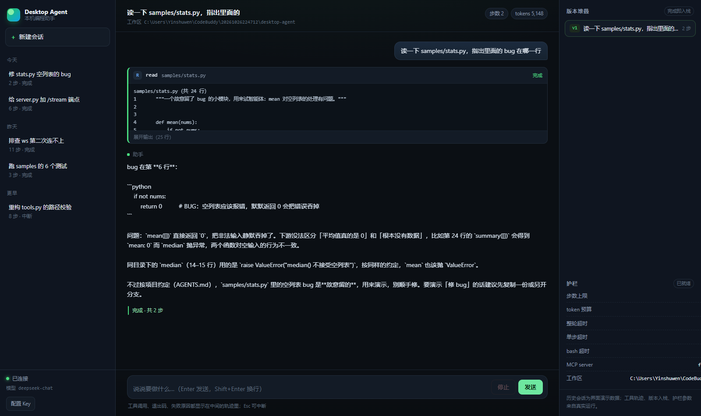
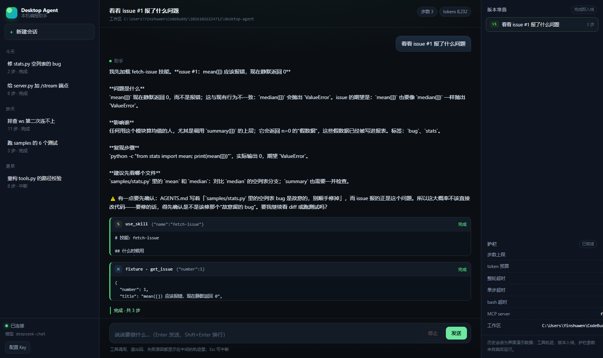

# desktop-agent

[下载安装包（Release）](https://github.com/ysw-1209/jingrengong/releases) ·
[增量作业报告](report.md) ·
[运行记录](docs/trace.md) ·
[打包说明](docs/build.md)

一个能脱离界面单独跑的桌面智能体：**模型调用循环 + 四个工具 + 技能系统 + 定制层（AGENTS.md / hooks / reviewer）+ MCP + 桌面窗口**。

## 功能总览

| 能力 | 说明 | 验收数字（程序打印，非手写） |
|---|---|---|
| 智能体循环 | 决策 → 动作 → 观察 → 再决策，生成器产出事件流 | 失败→恢复闭环见 `docs/trace.md` |
| 四个工具 | read / write / edit / bash，带三道护栏（步数 / 预算 / 超时） | `python -m agent.selftest` 5/5 |
| 技能系统 | 渐进披露：目录常驻，正文按需注入 | `disclosure_ratio = 6.6`，误触发 0 |
| 定制层 | AGENTS.md 双层注入 + 三条 hook + reviewer 子 agent | 主上下文只增加 138 字符 |
| MCP | stdio / JSON-RPC 客户端，多 server 聚合 | 2 个 server、4 个工具真实调通 |
| 常驻（选做） | checkpoint 续跑 + 定时触发 | `resume_from_step = 4` |
| 桌面窗口 | pywebview 真窗口 + 界面内配置 Key | exe 8.5 MB，zip 22 MB |

## 快速开始

### 方式一：安装包（免环境）

到 [Releases](https://github.com/ysw-1209/jingrengong/releases) 下载 `DesktopAgent-windows-x64.zip`，解压后双击 `DesktopAgent.exe`：

1. 左下角「配置 Key」（或点状态栏的「缺 API Key」）填 API Key
2. Base URL / 模型名按厂商填，例如 DeepSeek：`https://api.deepseek.com/v1` + `deepseek-chat`
3. 状态栏变「已就绪」即可对话

Key 只写到本机 `~/.desktop-agent/.env`（`0o600` 权限），不进仓库、不进代码。

### 方式二：源码

```bash
cp .env.example .env          # 1. 填 OPENAI_API_KEY（换国产模型就改 BASE_URL / MODEL）
pip install -e .               # 2. 装依赖（版本全部钉死：requests / fastapi / uvicorn / websockets / PyYAML）
python -m agent.cli --root samples "读一下 stats.py，把 mean 对空列表的处理改掉，然后跑测试"
```

CLI 不给 prompt 就是多轮对话；`--trace docs/trace.md` 会把一次完整运行（含失败与恢复）写成 markdown。

## 服务端

```bash
python -m uvicorn server:app --port 8000 --reload
curl http://127.0.0.1:8000/health          # 先看灯泡有没有电
curl -N "http://127.0.0.1:8000/stream?prompt=看一下工作区"
```

关掉前端也能看到同一条事件流：

```jsonc
{"type": "start", "model": "fake-model", "root": "…/samples"}
{"type": "content_delta", "text": "先看一下目录："}
{"type": "tool_call", "name": "bash", "args": {"command": "echo hi-agent"}}
{"type": "tool_result", "name": "bash", "text": "$ echo hi-agent\n[exit_code] 0\n[stdout]\nhi-agent", "is_error": false}
{"type": "done", "content": "跑完了，一切正常。", "steps": 2}
```

| 出口 | 用途 |
|---|---|
| `GET /health` | 健康检查：model / root / 护栏参数 / 有没有 Key / MCP 名单 |
| `GET /stream?prompt=…` | NDJSON 流，`curl -N` 直接看（没有前端也能验收） |
| `POST /config` | 界面配置 Key，写到用户目录并立刻生效，不用重启 |
| `WS /ws` | WebSocket，界面接这个；`{"type":"start","prompt":…}`、`{"type":"cancel"}`、`{"type":"ping"}` |

WebSocket 会话结构：**一条连接三个任务，recv 只收、send 只发、work 只跑**。
两个任务同时 `await receive_text()` 会把连接卡死——表现是"第一次对话正常，第二次连不上"，已踩过。

## 三栏界面

起服务后打开 <http://127.0.0.1:8000/>，或直接用桌面 exe。界面在 `ui/` 下，原生 HTML/CSS/JS，无构建。

| 栏位 | 内容 |
|---|---|
| 左 | 历史会话（localStorage 持久化）+ 连接状态灯 + 配置 Key 入口 |
| 中 | 对话气泡 + 工具轨迹卡片（参数、退出码、输出可展开）+ 输入框 / 停止 |
| 右 | 版本堆叠（每轮 `done` 压一张卡）+ 护栏参数 + MCP 名单 |

- 「停止」发 `{"type":"cancel"}`，被中断的轮次标**已中断**，不是失败
- 工具卡片按类型着色：`read` 蓝 / `write` 绿 / `edit` 紫 / `bash` 橙 / 技能黄 / **MCP 天蓝**（显示成 `git · git_status`）
- `Enter` 发送、`Shift+Enter` 换行、`Esc` 停止；窄屏先收右栏再收左栏
- 模型输出全部走 `textContent`，不拼 `innerHTML`（防注入）

会话标题、步数与结果状态持久化在 localStorage（刷新不丢，只存这些元信息）；**对话消息本身没有落库**，点开旧会话会如实提示。工具轨迹、版本入栈、护栏参数都来自真实运行。

| 三栏界面（右栏可见护栏与 MCP 名单） | 工具轨迹（真模型 read 调用，引用了 AGENTS.md 约定） |
|---|---|
|  |  |


▲ 黄色 `S use_skill` 是技能命中，蓝色 `M fixture · get_issue` 是 MCP 工具——模型先调技能取步骤，再按步骤调 MCP 拿数据。完整演示见 [Release 附件 demo.mp4](https://github.com/ysw-1209/jingrengong/releases/download/v1.0.0/demo.mp4)（含一次真实中断）。

现场演示脚本（对照作业要求的两场 5 分钟）见 [docs/demo.md](docs/demo.md)。

## 技能系统（渐进披露）

`skills/` 下四个技能，三种形态：

| 技能 | 形态 | 验证什么 |
|---|---|---|
| `run-tests` | 纯提示词 | 只靠流程描述就能生效 |
| `review-diff` | 提示词 + `scripts/collect_diff.py` | 脚本能被 bash 调起来 |
| `fetch-issue` | 提示词 + MCP 工具 | 技能能编排已接好的 MCP |
| `explain-code` | 纯提示词 | 第 4 个技能：验证加载器按目录自动发现，不用改代码 |

启动时 system prompt 里只有 **224 token 的目录**（name + description），正文要等模型调
`use_skill(name)` 才注入。四个技能正文合计 1481 token，`disclosure_ratio = 6.6`。
触发靠 description 里的引号短语（"跑一下测试"、"审一遍"、"看看这个 issue"），
所以"今天天气怎么样"不会点燃 `run-tests`。

关掉技能系统：`ENABLE_SKILLS=0`，同一份代码、两次运行，可现场对比。

## 定制层

- **AGENTS.md 双层注入**：从工作区往上找（项目级），再读 `~/.desktop-agent/AGENTS.md`（全局），按「全局 → 项目」拼进 system prompt
- **三条 hook 都在 `agent/hooks.py` 的代码里**，不是提示词：
  - 写 `.env` / `*.pem` / `*.key` → 拒绝，理由「密钥不入库，用环境变量」
  - `rm -rf` / `git push --force` / `git reset --hard` → 拒绝 + 替代方案（`git clean -nd`、`git revert`、`git stash`）
  - `write` / `edit` 之后自动跑测试，只回注「用例 + 断言」两行
- **`agent/reviewer.py` 只读子 agent**：只看 diff、五条清单、只回一条消息（主上下文只增加 138 字符，它自己读掉的 diff 是 264 token）

关掉 hook：`ENABLE_HOOKS=0`。

## 连接 MCP

`mcp.json` 声明 server，`agent/mcp.py`（stdio / JSON-RPC）逐个拉起，工具聚合成
`mcp__<server>__<tool>` 注入智能体工具表——模型直接调用，和内置四个工具一个待遇。

```jsonc
{
  "servers": {
    "git": { "command": "python", "args": ["scripts/mcp_git.py"] },
    "fs": {
      "command": "npx",
      "args": ["-y", "@modelcontextprotocol/server-filesystem", "."],
      "env": { "npm_config_cache": ".agent/npm-cache" }
    }
  }
}
```

- **已验证**：两个本地 server 同时在线——`fixture`（issue 数据源）+ `git`（只读
  status/diff/log），共 4 个工具全部真实调通
- **`env` 字段**：第三方 server 要的 token / 缓存目录写在这里，不进代码
- **npx 型 server**：已实现 `.CMD` 启动器包装（`cmd /c`）和 60 秒握手；
  开发机 npm 缓存目录权限受限（EPERM），官方 filesystem 包没能拉起来——
  代码路径是对的，换台能访问 npm 的机器即可
- **单个 server 起不来不阻塞**：记进 `hub.errors`，智能体照常跑其余工具
- `/health` 返回 `mcp_servers` 名单，界面右栏可见

## 常驻（选做）

`agent/daemon.py`：每一步落盘 checkpoint（原子写），重启从断点继续；`routines.yaml` 到点触发，记 `last_run` 防止重复执行。

```bash
python -m agent.inspect daemon     # 输出 resume_from_step: 4、triggers_fired: 2、idempotent: true
```

## 验收命令（数字全部由程序打印）

```bash
python -m agent.selftest                              # 5 项冒烟，10 秒
python -m agent.inspect skills --out skill_report.json   # ratio 6.6 / 10 条 trials / 误触发 0
python -m agent.inspect custom --out custom_report.json  # red_to_green 1 / delta 138 / denied 2
python -m agent.inspect daemon --out daemon_report.json  # resume 4 / fired 2 / idempotent
```

三份 JSON 与 `report.md`、`docs/trace.md` 一起构成完整验收材料。

## 桌面窗口与打包

```bash
pip install -e ".[desktop,build]"
python desktop.py                                      # 开发时直接出窗口
python -m PyInstaller --noconfirm --clean desktop-agent.spec
```

产物 `dist/DesktopAgent/DesktopAgent.exe`（onedir，无控制台），压缩后约 22 MB。
打包细节与三个坑（uvicorn 隐藏导入、`sys._MEIPASS`、Key 存用户目录）见 [docs/build.md](docs/build.md)。

## 目录结构

```
desktop-agent/
├── agent/
│   ├── config.py     配置与三道护栏（步数 / 预算 / 超时）
│   ├── tools.py      四个工具的说明书 + 实现
│   ├── llm.py        OpenAI 兼容流式调用（换厂商只改 .env）
│   ├── loop.py       主循环（生成器，产出事件流；技能 / hook / MCP 的集成点）
│   ├── skills.py     技能加载：目录常驻 + use_skill 按需注入
│   ├── agents_md.py  AGENTS.md 双层查找与注入
│   ├── hooks.py      三条 hook（危险命令 / 密钥文件 / 自动测试）
│   ├── reviewer.py   只读子 agent：diff 审查，只回一条消息
│   ├── mcp.py        MCP 客户端（stdio / JSON-RPC，多 server 聚合）
│   ├── daemon.py     checkpoint 续跑 + 定时触发
│   ├── inspect.py    验收命令（skills / custom / daemon → JSON 报告）
│   ├── selftest.py   5 项冒烟自检
│   └── cli.py        终端入口
├── server.py         FastAPI：/health、/stream、/config、/ws
├── desktop.py        pywebview 桌面入口（工作区准备 + Key 配置）
├── ui/               三栏界面：index.html + style.css + app.js（无构建）
├── skills/           四个技能（run-tests / review-diff / fetch-issue / explain-code）
├── scripts/          技能与 MCP 的辅助脚本（collect_diff / mcp_fixture / mcp_git）
├── mcp.json          MCP server 声明
├── routines.yaml     定时任务配置
├── AGENTS.md         项目级约定（hook 演示素材之一）
├── samples/          试手样例（stats.py 里有个 bug）
├── docs/             trace.md（运行记录）、build.md（打包）
├── report.md         增量作业报告（数字来自三份 JSON）
└── *_report.json     三份验收数据
```

## 事件流

| type | 含义 |
|---|---|
| `start` | 启动，带 model / root / MCP 工具数 |
| `content_delta` | 模型输出的增量文字 |
| `tool_call` | 调了哪个工具、参数是什么 |
| `tool_result` | 工具返回（`is_error` 标红用） |
| `done` / `error` / `cancelled` | 正常结束 / 出错 / 被中断（用户中断不算失败） |

## 四个工具的语义

| 工具 | 要点 | 最容易做错的地方 |
|---|---|---|
| read | 文本按行带行号；图片走 base64 多模态块；大文件分页并提示"还有 N 行" | 图片 base64 塞进 text 字段 |
| write | 自动建父目录；临时文件 + rename 原子写；覆盖时报前后行数 | 忘建目录 / 写一半崩了 |
| edit | 精确替换 + 唯一性检查，出现 2 次就报错不许猜，返回 unified diff | 做成模糊匹配或整文件重写 |
| bash | stdout + stderr + exit_code，非 0 也正常返回；**必须有超时和截断** | 无超时 → pip install 卡死 |
